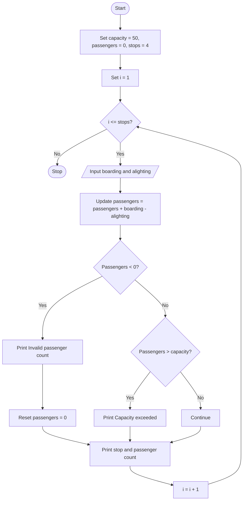

### Case Study 51: Bus Passenger Occupancy

### 1\. Problem Statement

Write a Python program to track the number of passengers on a bus over four stops. The bus has a maximum capacity of 50 passengers. At each stop, input the number of passengers boarding and alighting. Update the passenger count and display an error if the count becomes negative or exceeds the bus capacity.

### 2\. Algorithm

* Start.

* Set bus capacity to 50 and initial passengers to 0.

* Set the number of stops to 4.

* For each stop, read the number of passengers boarding and alighting.

* Update the passenger count by adding boarding passengers and subtracting alighting passengers.

* If the count is negative, display an invalid passenger count message and reset it to 0.

* If the count exceeds 50, display a capacity exceeded message.

* Display the stop number and the number of passengers inside.

* Repeat for all four stops.

* Stop.

### 3\. Flowchart (Mermaid Code)



### 4\. Python Source Code

```python

# Case Study 51: Bus Passenger Occupancy

capacity = 50
passengers = 0

stops = 4

for i in range(1, stops + 1):
    boarding = int(input("Passengers boarding: "))
    alighting = int(input("Passengers alighting: "))

    passengers = passengers + boarding - alighting

    if passengers < 0:
        print("Invalid passenger count")
        passengers = 0
    elif passengers > capacity:
        print("Capacity exceeded!")

    print("Stop:", i)
    print("Passengers inside:", passengers)
```

### 5\. Sample Input

```text
Passengers boarding: 10
Passengers alighting: 0
Passengers boarding: 15
Passengers alighting: 5
Passengers boarding: 20
Passengers alighting: 10
Passengers boarding: 5
Passengers alighting: 10
```

### 6\. Sample Output

```text
Stop: 1
Passengers inside: 10

Stop: 2
Passengers inside: 20

Stop: 3
Passengers inside: 30

Stop: 4
Passengers inside: 25
```

### 7\. Explanation

* `capacity = 50` sets the maximum number of passengers.

* `passengers = 0` means the bus starts empty.

* The `for` loop runs four times, once for each stop.

* `boarding` stores the number of passengers entering the bus.

* `alighting` stores the number of passengers leaving the bus.

* The passenger count is updated by adding boarding passengers and subtracting alighting passengers.

* The `if` condition checks whether the passenger count is negative.

* The `elif` condition checks whether the passenger count exceeds the capacity.

* Finally, the program displays the stop number and passenger count.
