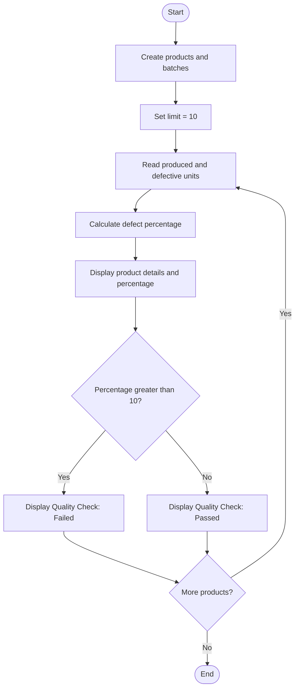

### Case Study 60: Quality Control

### 1\. Problem Statement

To calculate the defect percentage of each product and check whether it passes or fails the quality test based on a limit of 10%.

### 2\. Algorithm

* Create lists of product names and batch details.

* Set the defect percentage limit to 10%.

* Read the number of units produced and defective units for each product.

* Calculate the defect percentage.

* Display the product details and defect percentage.

* If the percentage is greater than 10%, display “Quality Check: Failed”.

* Otherwise, display “Quality Check: Passed”.

### 3\. Flowchart



### 4\. Python Source Code

```python

products = ["Product A", "Product B", "Product C"]
batches = [
    [100, 5],
    [200, 30],
    [150, 10]
]

limit = 10

for i in range(len(products)):
    produced = batches[i][0]
    defective = batches[i][1]

    percentage = (defective / produced) * 100

    print("\nProduct:", products[i])
    print("Units Produced:", produced)
    print("Defective Units:", defective)
    print("Defect Percentage:", round(percentage, 2), "%")

    if percentage > limit:
        print("Quality Check: Failed")
    else:
        print("Quality Check: Passed")
```

### 5\. Sample Input

```text
Product A: 100 produced, 5 defective
Product B: 200 produced, 30 defective
Product C: 150 produced, 10 defective
Quality limit = 10%
```

### 6\. Sample Output

```text

Product: Product A
Units Produced: 100
Defective Units: 5
Defect Percentage: 5.0 %
Quality Check: Passed

Product: Product B
Units Produced: 200
Defective Units: 30
Defect Percentage: 15.0 %
Quality Check: Failed

Product: Product C
Units Produced: 150
Defective Units: 10
Defect Percentage: 6.67 %
Quality Check: Passed
```

### 7\. Explanation

* Product A: — Passed.

* Product B: — Failed.

* Product C: — Passed.

Remember: Defect percentage = (Defective units ÷ Units produced) × 100. If it is greater than 10%, the quality check fails. Exactly 10% would pass.
