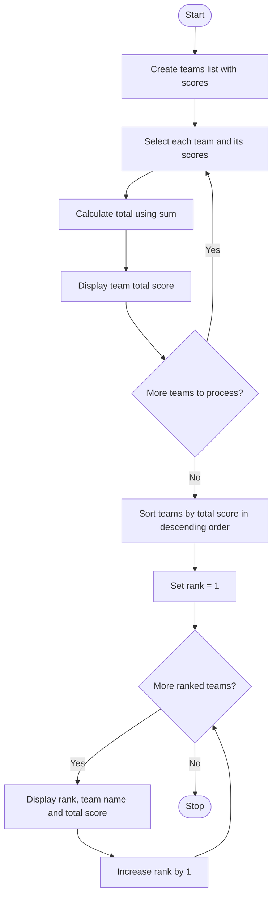

### Case Study 52: Hackathon Team Ranking

### 1\. Problem Statement

Write a Python program to calculate the total scores of hackathon teams and rank them from highest to lowest. Each team has scores from three judges. Display the total score of each team and its final rank.

### 2\. Algorithm

* Start.

* Create a list containing team names and their scores.

* Traverse the list using a `for` loop.

* Calculate the total score of each team using `sum()`.

* Display each team's total score.

* Sort the teams in descending order based on their total scores.

* Initialize `rank = 1`.

* Display each team's rank, name, and total score.

* Increase the rank by 1 after each team.

* Stop.

### 3\. Flowchart (Mermaid Code)



### 4\. Python Source Code

```python

# Case Study 52: Hackathon Team Ranking

teams = [
    ("Team A", [80, 90, 85]),
    ("Team B", [75, 88, 92]),
    ("Team C", [90, 95, 89])
]

for team, scores in teams:
    total = sum(scores)
    print(team, "Total Score:", total)

teams.sort(key=lambda x: sum(x[1]), reverse=True)

print("\nTeam Rankings:")
rank = 1

for team, scores in teams:
    print(rank, team, "Score:", sum(scores))
    rank += 1
```

### 5\. Sample Input

The program uses predefined team names and scores, so no user input is required.

```text
Team A: 80, 90, 85
Team B: 75, 88, 92
Team C: 90, 95, 89
```

### 6\. Sample Output

```text
Team A Total Score: 255
Team B Total Score: 255
Team C Total Score: 274

Team Rankings:
1 Team C Score: 274
2 Team A Score: 255
3 Team B Score: 255
```

### 7\. Explanation

* `teams` stores each team name and its three judges' scores as a tuple.

* `sum(scores)` calculates the total score of a team.

* `for team, scores in teams` accesses each team and its scores.

* `sort()` arranges the teams according to their total scores.

* `key=lambda x: sum(x[1])` calculates the total score for sorting.

* `reverse=True` sorts the teams from highest to lowest score.

* `rank = 1` initializes the ranking position.

* `rank += 1` increases the rank after displaying each team.
