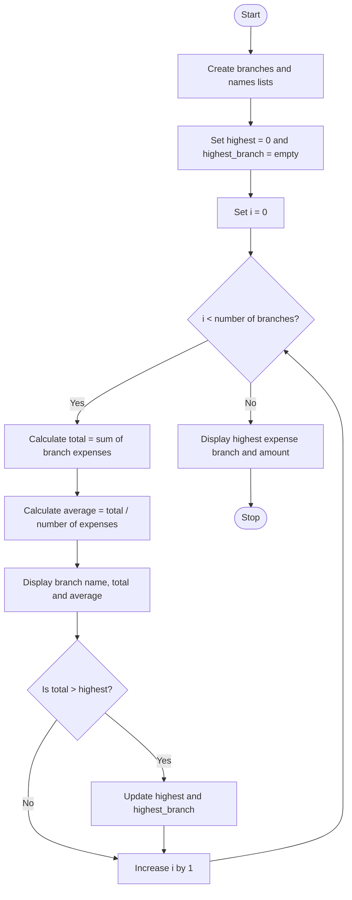

### Case Study 54: Branch Expense Analysis

### 1\. Problem Statement

Write a Python program to analyze the expenses of three branches. Calculate the total and average expenses of each branch and identify the branch with the highest total expenses.

### 2\. Algorithm

* Start.

* Create a list containing the expenses of three branches.

* Store the branch names in a separate list.

* Initialize `highest = 0` and `highest_branch = ""`.

* Traverse each branch using a `for` loop.

* Calculate the total expenses using `sum()`.

* Calculate the average expenses by dividing the total by the number of expenses.

* Display the total and average expenses of each branch.

* If the total is greater than `highest`, update `highest` and `highest_branch`.

* Display the branch with the highest expenses and its amount.

* Stop.

### 3\. Flowchart (Mermaid Code)



### 4\. Python Source Code

```python

# Case Study 54: Branch Expense Analysis

branches = [
    [1000, 1500, 1200],
    [2000, 1800, 1600],
    [900, 1100, 1300]
]

names = ["Branch A", "Branch B", "Branch C"]
highest = 0
highest_branch = ""

for i in range(len(branches)):
    total = sum(branches[i])
    average = total / len(branches[i])

    print(names[i])
    print("Total Expenses:", total)
    print("Average Expense:", average)

    if total > highest:
        highest = total
        highest_branch = names[i]

print("\nHighest Expense:", highest_branch)
print("Amount:", highest)
```

### 5\. Sample Input

The program uses predefined expense lists, so no user input is required.

```text
Branch A: 1000, 1500, 1200
Branch B: 2000, 1800, 1600
Branch C: 900, 1100, 1300
```

### 6\. Sample Output

```text
Branch A
Total Expenses: 3700
Average Expense: 1233.3333333333333
Branch B
Total Expenses: 5400
Average Expense: 1800.0
Branch C
Total Expenses: 3300
Average Expense: 1100.0

Highest Expense: Branch B
Amount: 5400
```

### 7\. Explanation

* `branches` stores the expenses of each branch.

* `names` stores the branch names.

* `sum(branches[i])` calculates the total expenses.

* `len(branches[i])` counts the number of expenses.

* `average = total / len(branches[i])` calculates the average.

* `if total > highest` checks whether the current branch has higher expenses than the previous highest.

* `highest_branch` stores the name of the branch with the highest expenses.

Remember: Branch B has the highest total expenses of 5400.
