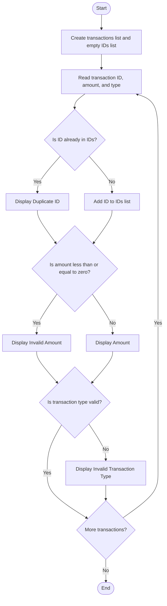

### Case Study 55: Transaction Audit

### 1\. Problem Statement

To check bank transactions for duplicate transaction IDs, invalid amounts, and invalid transaction types.

### 2\. Algorithm

* Create a list of transactions and an empty list to store transaction IDs.

* Read each transaction's ID, amount, and type.

* Check whether the ID is duplicated.

* Check whether the amount is less than or equal to zero.

* Check whether the transaction type is valid.

* Display the results.

### 3\. Flowchart



### 4\. Python Source Code

```python

transactions = [
    (101, 500, "Deposit"),
    (102, 1000, "Withdrawal"),
    (103, -200, "Deposit"),
    (101, 700, "Deposit")
]

ids = []

for transaction in transactions:
    tid, amount, kind = transaction

    print("\nTransaction:", tid)

    if tid in ids:
        print("Duplicate transaction ID")
    else:
        ids.append(tid)

    if amount <= 0:
        print("Invalid amount")
    else:
        print("Amount:", amount)

    if kind not in ("Deposit", "Withdrawal"):
        print("Invalid transaction type")
```

### 5\. Sample Input

The program uses these predefined transactions:

* `(101, 500, "Deposit")`

* `(102, 1000, "Withdrawal")`

* `(103, -200, "Deposit")`

* `(101, 700, "Deposit")`

### 6\. Sample Output

```text

Transaction: 101
Amount: 500

Transaction: 102
Amount: 1000

Transaction: 103
Invalid amount

Transaction: 101
Duplicate transaction ID
Amount: 700
```

### 7\. Explanation

* Transaction 101: Valid ID and amount.

* Transaction 102: Valid ID and amount.

* Transaction 103: Invalid because the amount is negative.

* Transaction 101 again: The ID is duplicated, but the amount is valid.

* All transaction types are valid, so no invalid-type message appears.
