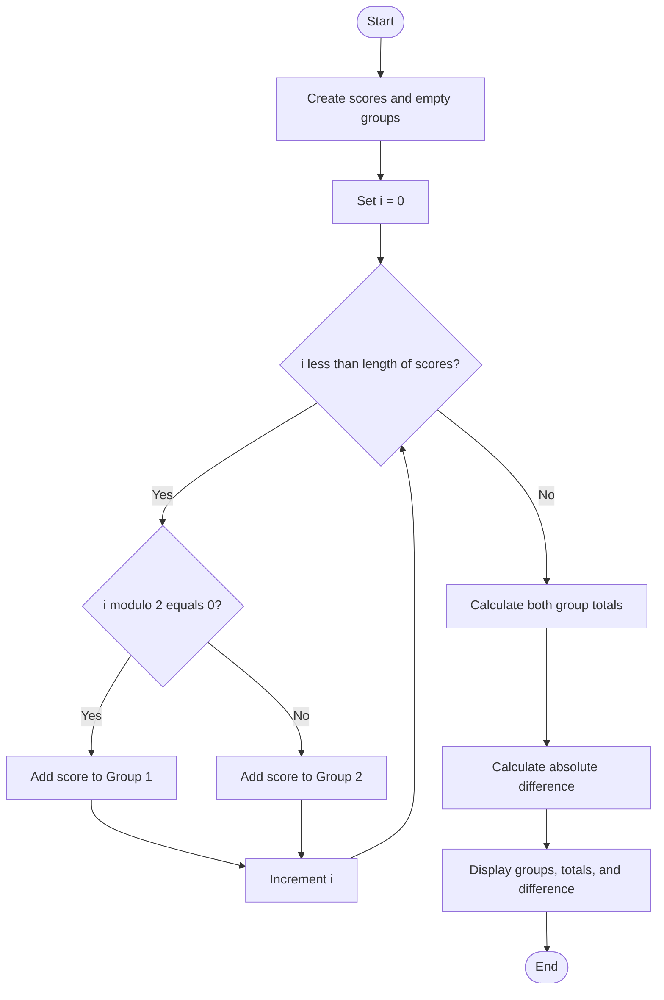

### Case Study 56: Student Group Formation

### 1\. Problem Statement

To divide students into two groups based on their positions in a list, calculate each group's total score, and find the difference between the totals.

### 2\. Algorithm

* Create a list of student scores.

* Create two empty groups.

* Check each score's index.

* If the index is even, add the score to Group 1.

* Otherwise, add the score to Group 2.

* Calculate the total score of each group.

* Find and display the difference between the totals.

### 3\. Flowchart



### 4\. Python Source Code

```python

scores = [80, 70, 90, 60, 85, 75]
group1 = []
group2 = []

for i in range(len(scores)):
    if i % 2 == 0:
        group1.append(scores[i])
    else:
        group2.append(scores[i])

print("Group 1:", group1)
print("Group 1 Total:", sum(group1))

print("Group 2:", group2)
print("Group 2 Total:", sum(group2))

difference = abs(sum(group1) - sum(group2))
print("Difference between totals:", difference)
```

### 5\. Sample Input

```text
Scores = [80, 70, 90, 60, 85, 75]
```

### 6\. Sample Output

```text

Group 1: [80, 90, 85]
Group 1 Total: 255
Group 2: [70, 60, 75]
Group 2 Total: 205
Difference between totals: 50
```

### 7\. Explanation

* Group 1: Scores at even indices: 80, 90, 85.

* Group 2: Scores at odd indices: 70, 60, 75.

* Group 1 Total: 80 + 90 + 85 = 255.

* Group 2 Total: 70 + 60 + 75 = 205.

* Difference: .

Remember: Even index → Group 1; odd index → Group 2.
