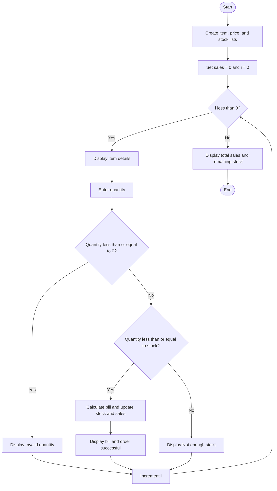

### Case Study 57: Canteen Management

### 1\. Problem Statement

To display canteen items, accept the quantity ordered, calculate bills, update stock, and calculate total sales.

### 2\. Algorithm

* Create lists for item names, prices, and stock.

* Initialize total sales to zero.

* Display each item's name, price, and available stock.

* Ask the customer to enter the quantity.

* If the quantity is less than or equal to zero, display “Invalid quantity”.

* If stock is sufficient, calculate the bill and update the stock and sales.

* Otherwise, display “Not enough stock”.

* Display total sales and remaining stock.

### 3\. Flowchart



### 4\. Python Source Code

```python

items = ["Idli", "Dosa", "Meals"]
prices = [30, 50, 80]
stock = [20, 15, 10]

sales = 0

for i in range(3):
    print(i + 1, items[i], "- Rs.", prices[i],
          "- Stock:", stock[i])

    quantity = int(input("Enter quantity to order: "))

    if quantity <= 0:
        print("Invalid quantity")
    elif quantity <= stock[i]:
        bill = quantity * prices[i]
        stock[i] -= quantity
        sales += bill

        print("Bill: Rs.", bill)
        print("Order successful")
    else:
        print("Not enough stock")

print("\nTotal Sales: Rs.", sales)
print("Remaining Stock:", stock)
```

### 5\. Sample Input

For this example, enter these quantities when prompted:

```text
Idli quantity: 2
Dosa quantity: 3
Meals quantity: 1
```

### 6\. Sample Output

```text

1 Idli - Rs. 30 - Stock: 20
Enter quantity to order: 2
Bill: Rs. 60
Order successful
2 Dosa - Rs. 50 - Stock: 15
Enter quantity to order: 3
Bill: Rs. 150
Order successful
3 Meals - Rs. 80 - Stock: 10
Enter quantity to order: 1
Bill: Rs. 80
Order successful

Total Sales: Rs. 290
Remaining Stock: [18, 12, 9]
```

### 7\. Explanation

* Idli: 2 × ₹30 = ₹60; remaining stock = 18.

* Dosa: 3 × ₹50 = ₹150; remaining stock = 12.

* Meals: 1 × ₹80 = ₹80; remaining stock = 9.

* Total Sales: ₹60 + ₹150 + ₹80 = ₹290.

Remember: The program checks the quantity, calculates the bill, reduces stock, and updates total sales.
