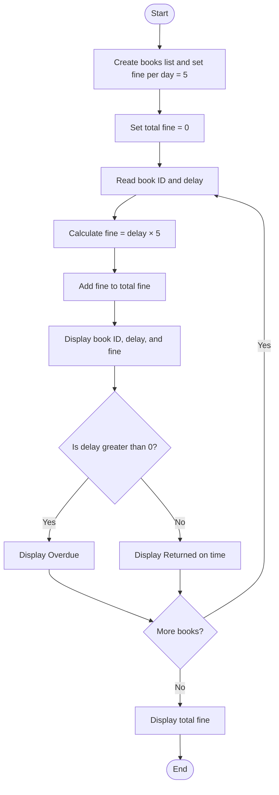

### Case Study 58: Library Fine Calculation

### 1\. Problem Statement

To calculate the fine for each overdue book based on the number of delayed days and find the total fine for all books.

### 2\. Algorithm

* Create a list containing book IDs and overdue days.

* Set the fine per day to ₹5 and total fine to zero.

* Read each book ID and its overdue days.

* Calculate the fine by multiplying overdue days by ₹5.

* Add each fine to the total fine.

* Display the book details and return status.

* Display the total fine.

### 3\. Flowchart



### 4\. Python Source Code

```python

books = [
    ("B101", 3),
    ("B102", 0),
    ("B103", 5),
    ("B104", 2)
]

fine_per_day = 5
total_fine = 0

for book_id, delay in books:
    fine = delay * fine_per_day
    total_fine += fine

    print("\nBook ID:", book_id)
    print("Days Overdue:", delay)
    print("Fine: Rs.", fine)

    if delay > 0:
        print("Status: Overdue")
    else:
        print("Status: Returned on time")

print("\nTotal Fine: Rs.", total_fine)
```

### 5\. Sample Input

The program uses these predefined values:

```text
B101 → 3 days
B102 → 0 days
B103 → 5 days
B104 → 2 days
Fine per day = ₹5
```

### 6\. Sample Output

```text

Book ID: B101
Days Overdue: 3
Fine: Rs. 15
Status: Overdue

Book ID: B102
Days Overdue: 0
Fine: Rs. 0
Status: Returned on time

Book ID: B103
Days Overdue: 5
Fine: Rs. 25
Status: Overdue

Book ID: B104
Days Overdue: 2
Fine: Rs. 10
Status: Overdue

Total Fine: Rs. 50
```

### 7\. Explanation

* B101: 3 × ₹5 = ₹15

* B102: 0 × ₹5 = ₹0

* B103: 5 × ₹5 = ₹25

* B104: 2 × ₹5 = ₹10

Total fine = ₹15 + ₹0 + ₹25 + ₹10 = ₹50.

Remember: Fine = Overdue days × Fine per day. If the delay is greater than zero, the book is overdue.
