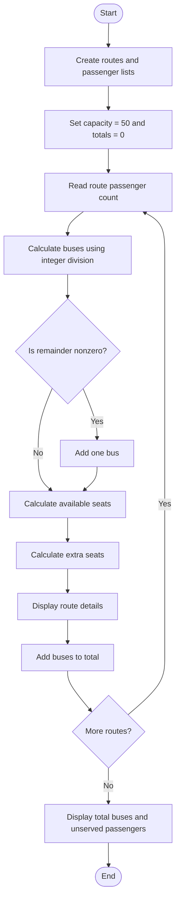

### Case Study 59: Campus Transport Allocation

### 1\. Problem Statement

To calculate the number of buses required for each campus route based on the number of passengers and bus capacity, find extra seats, and calculate the total buses required.

### 2\. Algorithm

* Create lists of routes and passenger counts.

* Set bus capacity to 50.

* Initialize total buses and unserved passengers to zero.

* Calculate the buses required for each route.

* If passengers remain after division, add one extra bus.

* Calculate and display extra seats.

* Calculate the total number of buses required.

* Display total buses and unserved passengers.

### 3\. Flowchart



### 4\. Python Source Code

```python

routes = ["Route A", "Route B", "Route C"]
passengers = [120, 85, 150]
capacity = 50

total_buses = 0
unserved = 0

for i in range(len(routes)):
    buses = passengers[i] // capacity

    if passengers[i] % capacity != 0:
        buses += 1

    available_seats = buses * capacity
    remaining = available_seats - passengers[i]

    print("\nRoute:", routes[i])
    print("Passengers:", passengers[i])
    print("Buses Required:", buses)
    print("Extra Seats:", remaining)

    total_buses += buses

print("\nTotal Buses Required:", total_buses)
print("Unserved Passengers:", unserved)
```

### 5\. Sample Input

```text
Bus capacity = 50

Route A = 120 passengers
Route B = 85 passengers
Route C = 150 passengers
```

### 6\. Sample Output

```text

Route: Route A
Passengers: 120
Buses Required: 3
Extra Seats: 30

Route: Route B
Passengers: 85
Buses Required: 2
Extra Seats: 15

Route: Route C
Passengers: 150
Buses Required: 3
Extra Seats: 0

Total Buses Required: 8
Unserved Passengers: 0
```

### 7\. Explanation

* Route A: 120 ÷ 50 requires 3 buses. Extra seats = 150 − 120 = 30.

* Route B: 85 ÷ 50 requires 2 buses. Extra seats = 100 − 85 = 15.

* Route C: 150 ÷ 50 requires 3 buses. Extra seats = 150 − 150 = 0.

* Total buses: 3 + 2 + 3 = 8.

* Unserved passengers: 0, because enough buses are allocated.

Remember: Use `//` to find the whole number of buses and `%` to check whether another bus is needed.
